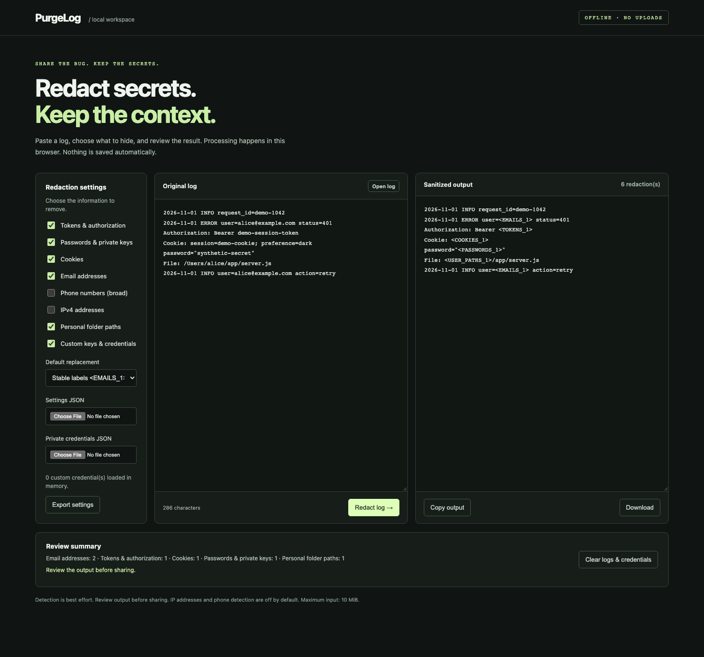
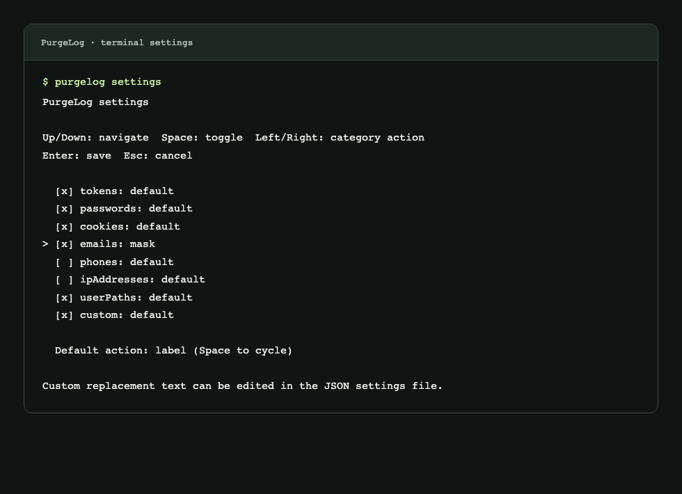
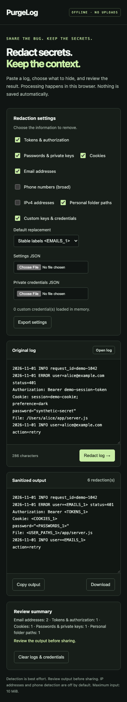

# PurgeLog

**Redact secrets. Keep the context.**

An offline log sanitizer with a CLI, checkbox settings TUI, local paste-and-copy GUI, and a reusable JavaScript library. All interfaces share the same redaction core. No runtime dependencies, account, telemetry, external API, or cloud processing.

> Early release: detection is best effort. Review sanitized output before sharing. A result with zero findings does not prove that a log contains no secrets.

## Screenshots

### Local GUI

Paste logs, select redaction categories, and review the sanitized output before copying. This screenshot uses synthetic data only.



<details>
<summary>Terminal settings</summary>

The settings TUI supports category checkboxes and per-category replacement actions. The image below renders output captured from a live `purgelog settings` terminal session.



</details>

<details>
<summary>Mobile browser layout</summary>

The same local GUI adapts to narrow browser windows.



</details>

## Install

Requires Node.js 22 or later. Version `0.1.0` is available on [npm](https://www.npmjs.com/package/purgelog).

```sh
npm install --global purgelog@0.1.0
purgelog --help
```

To install directly from source:

```sh
git clone https://github.com/amirhdolati/PurgeLog.git
cd PurgeLog
npm install --global .
purgelog --help
```

Alternatively, run `node bin/purgelog.js` directly. No build step is required. Installation may need internet access; execution does not.

## CLI

```sh
purgelog application.log -o sanitized.log
cat application.log | purgelog > sanitized.log
purgelog application.log --action mask --summary
purgelog application.log --config ./purgelog.json --secrets ./purgelog.secrets.json
purgelog application.log --action replace --replacement '[PRIVATE]'
```

The `-o` option creates a new file with private permissions and refuses existing output files. Input files are not modified. Shell redirection (`>`) follows your shell's overwrite behavior: never redirect onto the input file. Sanitized text goes to stdout; optional counts and errors go to stderr. Errors use exit code 1. There is a 10 MiB input limit; this release buffers input and does not stream unlimited files.

### Settings TUI

```sh
purgelog settings
purgelog settings --config ./team-settings.json
```

Use Up/Down to navigate, Space to toggle checkboxes, Left/Right to choose a category's replacement action, and Enter to save. Existing settings require a separate Y confirmation before replacement. Esc or Ctrl+C cancels. Use JSON to edit sensitive field names and custom replacement text. Existing malformed configuration files are rejected. Credentials are never written by the settings editor.

### Local GUI

```sh
purgelog gui
purgelog gui --config ./purgelog.json --secrets ./purgelog.secrets.json
purgelog gui --no-open
```

The GUI opens in your browser. Paste a log or open a file, choose categories, click **Redact log**, review the output, and copy or download it. Changing input or settings invalidates old output. Settings and private credential files can be selected in the page; file contents stay in browser memory. Settings exports exclude credential values. Invalid rule files block processing until a valid file is loaded or the workspace is explicitly cleared.

The local server binds only to `127.0.0.1` on a random port, serves bundled assets on a random session path, rejects foreign Host/Origin headers, and disables caching. Log text is processed in the browser, not sent to the local server. CLI-provided settings/credentials are delivered to that browser over loopback. No CDN, external font, remote request, or automatic persistent browser storage is used. Ctrl+C closes the server. Clear the workspace or close the tab when finished. Clipboard contents and downloaded files remain under your control; clearing the page does not erase them.

## Input and output examples

All values below are synthetic. Outputs are generated by the same core used by the CLI and GUI. Categories not mentioned use the defaults.

### Application logs and repeated identities

```sh
purgelog application.log
```

Input:

```text
2026-11-01 INFO user=alice@example.com action=sign-in
2026-11-01 ERROR user=alice@example.com password="demo-password" status=401
File: /Users/alice/project/server.js
```

Output:

```text
2026-11-01 INFO user=<EMAILS_1> action=sign-in
2026-11-01 ERROR user=<EMAILS_1> password="<PASSWORDS_1>" status=401
File: <USER_PATHS_1>/project/server.js
```

### HTTP headers and URLs

```sh
purgelog request.log
```

Input:

```text
Authorization: Bearer demo-session-token
Cookie: session=demo-cookie; preference=dark
GET https://service.example/api?api_key=demo-api-key&status=active
```

Output:

```text
Authorization: Bearer <TOKENS_1>
Cookie: <COOKIES_1>
GET https://service.example/api?api_key=<TOKENS_2>&status=active
```

### Nested JSON

```sh
purgelog event.json
```

Input:

```json
{
  "event": "request_failed",
  "user": {
    "email": "alice@example.com"
  },
  "password": {
    "current": "demo-password",
    "history": [
      "old-demo-password"
    ]
  },
  "status": 500
}
```

Output:

```json
{
  "event": "request_failed",
  "user": {
    "email": "<EMAILS_1>"
  },
  "password": "<PASSWORDS_1>",
  "status": 500
}
```

### JSON Lines

```sh
purgelog events.jsonl
```

Input:

```json
{"event":"login","accessToken":"demo-token","status":200}
{"event":"retry","password":12345,"attempt":2}
```

Output:

```json
{"event":"login","accessToken":"<TOKENS_1>","status":200}
{"event":"retry","password":"<PASSWORDS_1>","attempt":2}
```

### Custom fields and exact credentials

For this example, set `sensitiveKeys` to `["customer_mobile"]` in your settings and use the synthetic credential from [`examples/credentials.example.json`](examples/credentials.example.json) in your private credentials file.

```sh
purgelog application.log --config ./purgelog.json --secrets ./purgelog.secrets.json
```

Input:

```text
customer_mobile="+1 202 555 0198"
upstream=demo-secret-not-a-real-key
status=retry
```

Output:

```text
customer_mobile="<CUSTOM_1>"
upstream=<CUSTOM_2>
status=retry
```

### Choose a replacement style

For the synthetic input `password=demo-password`:

| CLI options | Output |
| --- | --- |
| `--action label` | `password=<PASSWORDS_1>` |
| `--action mask` | `password=********` |
| `--action remove` | `password=` |
| `--action replace --replacement '[PRIVATE]'` | `password=[PRIVATE]` |

Stable labels preserve repeated identities within one run. The `mask` action always emits eight stars, regardless of the original secret length.

## Configuration

`purgelog.json` contains shareable settings:

```json
{
  "version": 1,
  "action": "label",
  "categories": {
    "emails": { "enabled": true, "action": "mask" },
    "phones": { "enabled": false },
    "ipAddresses": { "enabled": false }
  },
  "sensitiveKeys": ["customer_mobile", "internal_api_key"]
}
```

Keep actual credential values in a **separate private file**, outside version control:

```json
{
  "version": 1,
  "credentials": [
    {
      "name": "synthetic-example",
      "value": "demo-secret-not-a-real-key",
      "action": "label"
    }
  ]
}
```

These are synthetic examples. Credential values are matched literally (including JSON-escaped forms), not as regex. Values must be 3–16384 characters; up to 200 entries are supported. Use restrictive file permissions, such as `chmod 600 purgelog.secrets.json` on Unix. The supplied `.gitignore` excludes that exact filename; protect any other private filenames yourself. Never put real secret values in CLI arguments, examples, issues, or tests. Configuration is JSON data; it cannot execute code. Unknown properties and unsupported versions are rejected.

### Categories

| Category | Default | Recognizes |
| --- | --- | --- |
| `tokens` | On | Common token keys, Bearer/Basic credentials, JWT-like tokens, selected GitHub/AWS/Stripe key formats |
| `passwords` | On | Password/secret keys, PEM private-key blocks, URL userinfo |
| `cookies` | On | Cookie/Set-Cookie fields and headers |
| `emails` | On | Common ASCII email address patterns |
| `phones` | Off | Broad phone-like number patterns; can match IDs or dates |
| `ipAddresses` | Off | IPv4 addresses; IPv6 is not currently detected |
| `userPaths` | On | `/Users/name`, `/home/name`, and Windows `Users` directory prefixes |
| `custom` | On | Additional sensitive keys and literal credentials |

Actions: `label` assigns stable per-call labels, `mask` emits exactly eight stars, `remove` empties a value, and `replace` uses custom `replacement` text. Credential action overrides category action, which overrides the global action. Overlapping findings are merged to prevent leaking unmatched suffixes. Labels are stable within one call; no mapping is persisted across calls. Reports expose categories and source/output offsets, not original matched values or credential names.

Valid JSON and valid object/array records in JSON Lines are processed structurally for sensitive keys, including nested arrays/objects and escaped property names. Sensitive values become replacement strings; keys and unrelated source formatting are retained. Structured output is validated before being returned; custom matches that would break record syntax fail closed. Plain text uses pattern matching. Malformed JSON, escaped/encoded values, uncommon credential formats, and custom text formats can require additional review or literal credential rules. Replacement text is user-controlled: do not set it to a real secret. At most 50,000 candidate findings are processed per call; split dense logs if this limit is reached.

## Library

```sh
# From another project:
npm install purgelog@0.1.0

# Or install a local checkout:
npm install /absolute/path/to/PurgeLog
```

```js
import { createSanitizer, sanitize } from 'purgelog';

const cleaner = createSanitizer({
  categories: { emails: { enabled: true, action: 'mask' } },
  sensitiveKeys: ['customer_mobile'],
  credentials: [{ name: 'example', value: 'synthetic-secret' }]
});

const result = cleaner.sanitize('password=synthetic-secret user=alice@example.com');
console.log(result.text);
console.log(result.summary);

const oneShot = sanitize('Authorization: Bearer synthetic-token');
```

ES modules and TypeScript declarations are included. The browser-compatible core imports no Node modules, performs no I/O, and never logs or persists input. Each call returns `{ text, findings, summary, total }`. Offsets use JavaScript UTF-16 string indexes, not byte offsets. The sanitized output may still contain undetected secrets; do not treat the entire result as safe without review.

## Development

```sh
npm test
npm pack --dry-run
```

Tests cover synthetic credentials, JSON structure, Unicode, overlaps, CLI output safety, invalid config, and local GUI HTTP boundaries. Use synthetic data for contributions. Read [SECURITY.md](SECURITY.md) for limitations and reporting guidance.

## Architecture

```text
src/core/       Pure detection, overlap resolution, replacement, public types
src/config.js  Filesystem adapter and configuration composition
bin/           CLI adapter and process lifecycle
src/tui.js     Terminal settings editor
src/gui/       Loopback asset server and browser interface
test/          Synthetic core and interface regressions
```

## Support

Bug reports, synthetic regression cases, and documentation improvements are welcome.

## License

MIT.

## Donate

If PurgeLog helps you share logs more safely, you can support its development with a voluntary donation.

**Network: TRON**

```text
TZ6HTiRLeyWoFJ5rGgx6qbMyjLAHNb6hfb
```


Donations are optional. All features remain free and open source.
